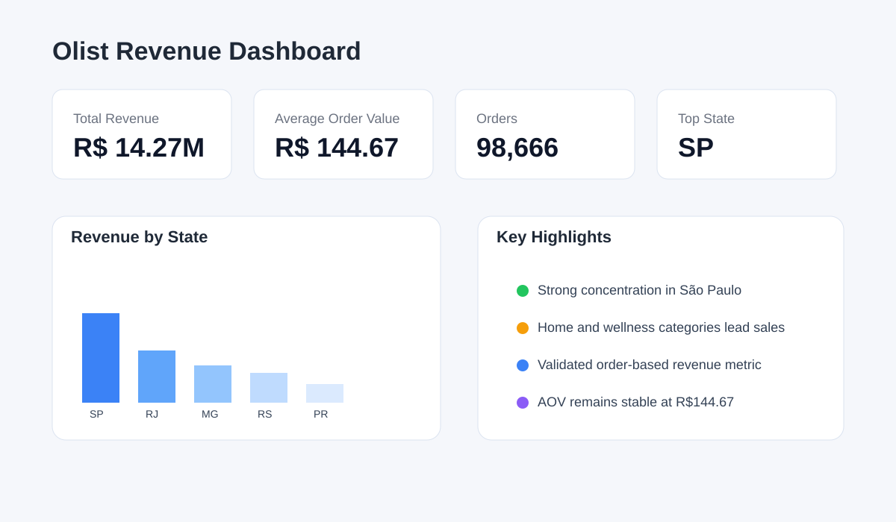
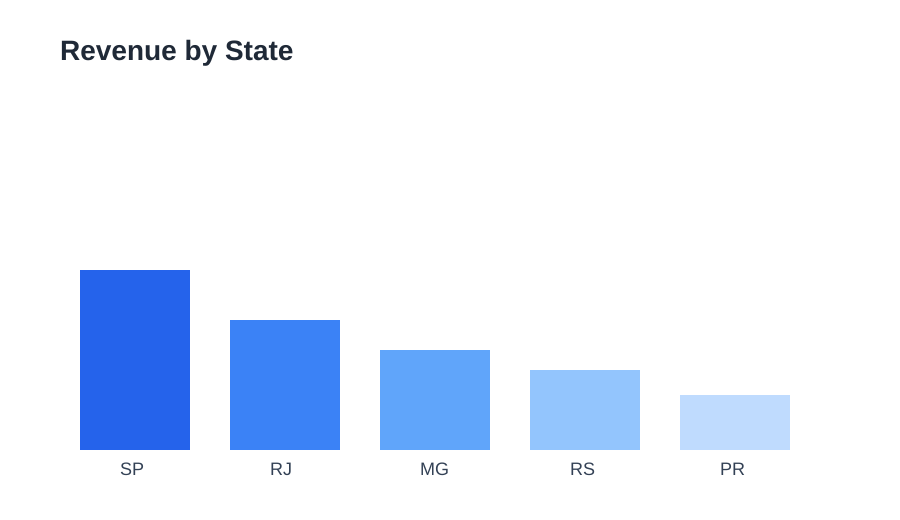
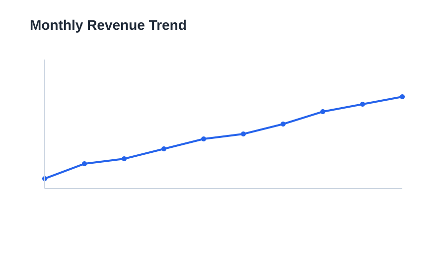

# Olist Data Analytics Project

## Project Overview
This project analyzes the Olist Brazilian e-commerce dataset to understand revenue generation, customer behavior, seller performance, and delivery trends. The work combines transactional order data, product information, payment records, customer and seller geography, and review data to produce a business-focused analytical story for growth and operations.

The goal is to answer core business questions such as:
- What is the total revenue generated by Olist orders?
- Which customer states and product categories generate the most revenue?
- Which sellers and cities contribute the most value?
- How does revenue vary across time and payment behavior?

## Tools and Stack
- Python for data processing and analysis
- Pandas for data wrangling and aggregations
- Matplotlib and Seaborn for exploratory charts
- SQL for revenue and trend queries
- Power BI for dashboard presentation and business storytelling

## Dataset
The project uses the Olist public dataset, including:
- orders
- customers
- order items
- payments
- products
- sellers
- reviews
- geolocation

The cleaned data used for the final metrics is stored in:
- data/cleaned/olist_final_dataset.csv

## Data Preparation and Methodology
1. Loaded raw Olist CSV files from the data/raw folder.
2. Standardized keys across orders, products, sellers, and payments.
3. Merged customer, order, item, payment, and review tables into a single analytical dataset.
4. Cleaned nulls, normalized timestamps, and created time-based fields such as purchase month and year.
5. Aggregated item-level revenue using order_id and price to avoid duplication from payment rows.
6. Compared payment totals against item-level totals to validate that revenue should not be derived from raw payment records when multiple payment rows exist per order.

## Revenue Validation
A key validation step was to ensure the reported revenue and average order value (AOV) were not inflated by duplicated rows after the payment and item tables were merged.

The correct calculation is:
- Total revenue = SUM(price) aggregated at the order-item level
- Average order value = mean(order_revenue per order)

This yields:
- Total revenue: R$14,273,699.65
- Average order value: R$144.67 per order

Important note:
The raw merged payment data can overstate order value because a single order may have multiple payment rows or repeated payment records. Summing payment_value directly therefore overcounts revenue and is not appropriate for the final KPI definition.

## Dashboard Screenshots

### Executive overview

### Revenue by state

### Monthly revenue trend

## Key Findings
- São Paulo is the dominant market by revenue, followed by Rio de Janeiro and Minas Gerais.
- Product categories such as furniture, home goods, and wellness items are among the strongest revenue drivers.
- The aggregated order-level AOV of R$144.67 confirms the value of a typical purchase while remaining consistent with item-level revenue logic.
- Revenue concentration by state and category highlights the strongest expansion opportunities for targeted marketing and inventory planning.
- Delivery timing and order status patterns also indicate optimization areas for customer experience improvement.

## Project Status
This project is finalized with validated KPI definitions, cleaned analytics data, and a business-ready summary for stakeholder review.
